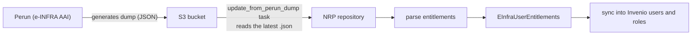

import { Callout } from "nextra/components";

# AAI — e-INFRA OIDC Authentication & Group Sync

<Callout type="info">
This page describes the current (RDM 14) state, as implemented in the
[oarepo-config](https://github.com/oarepo/oarepo-config) and
[oarepo-oidc-einfra](https://github.com/oarepo/oarepo-oidc-einfra) packages.
The main difference from RDM 12: group synchronization now happens via an
**S3 dump file**, not via the Perun REST API.
</Callout>

## Overview

AAI (Authentication and Authorization Infrastructure) in an NRP repository does two things:

1. **Login** — users authenticate via e-INFRA/Perun OIDC (the same way as on other CESNET services)
2. **Group synchronization** — VO and community group memberships are loaded from an S3 dump generated by Perun

Both are configured in `invenio.cfg` with a single call to `config.configure_einfra_oidc()`.

---

## 1. Prerequisites (e-INFRA side)

Before configuring the repository, the following must be in place on the e-INFRA AAI side:

### 1.1 OIDC client in spadmin

Create an OIDC client in the [spadmin console](https://spadmin.e-infra.cz/):

| Configuration | Value |
|---|---|
| URL of login page | `https://<server>/oauth/login/e-infra/` |
| Redirect URIs | `https://<server>/oauth/authorized/e-infra/` |
| Flow | authorization code |
| Token endpoint auth | `client_secret_basic` |
| PKCE | none |
| Introspection | yes |
| Scopes | `openid profile email eduperson_entitlement organization` |

**Note:** The scope list is hardcoded in `oarepo-oidc-einfra` (in `remote.py`), not in the repository
configuration — in spadmin it is enough to allow `eduperson_entitlement` and `organization`.

### 1.2 Perun dump to S3

Perun must generate a regular dump of users and groups into an S3 bucket that the repository reads.
This is set up by the e-INFRA AAI team.

### 1.3 e-INFRA eligible users (optional)

If you want e-INFRA eligible users to automatically receive rights (e.g. the global `submitter`
role or community roles), use `einfra_eligible_parser_factory` from `oarepo-oidc-einfra`.
See the example in [NRP-CZ/datarepo](https://github.com/NRP-CZ/datarepo/blob/main/invenio.cfg).

---

## 2. Repository configuration (`invenio.cfg`)

```python filename="invenio.cfg"
import oarepo_config as config

# ... other configuration ...

# AAI — e-INFRA OIDC
# Requires the oarepo-oidc-einfra package
from oarepo_oidc_einfra.remote import einfra_eligible_parser_factory

config.configure_einfra_oidc(
    entitlements_parser=einfra_eligible_parser_factory(
        # Optional: map e-INFRA eligibility to roles
        # global_roles=["submitter"],
        # community_roles=[("my-community", "curator")],
    )
)
```

What `configure_einfra_oidc()` does:

- When `INVENIO_REMOTE_AUTH_ENABLED` is `true` (also `yes`/`1`), merges an `"e-infra"` entry into `OAUTHCLIENT_REMOTE_APPS`
- Builds the `EINFRA` client configuration from `INVENIO_EINFRA_CONSUMER_KEY` and `INVENIO_EINFRA_CONSUMER_SECRET`
- Sets `USERPROFILES_READ_ONLY = True` (users cannot edit their profile, as it is managed by e-INFRA)
- When `INVENIO_REMOTE_AUTH_ENABLED` is not enabled, `OAUTHCLIENT_REMOTE_APPS` stays empty — AAI login is disabled
- Requires the `oarepo-oidc-einfra` package; if it is missing, the application refuses to start

### 2.1 Required environment variables

| Variable | Description |
|---|---|
| `INVENIO_REMOTE_AUTH_ENABLED` | `true` to enable AAI login |
| `INVENIO_EINFRA_CONSUMER_KEY` | OIDC client key from spadmin |
| `INVENIO_EINFRA_CONSUMER_SECRET` | OIDC client secret from spadmin |

### 2.2 S3 dump synchronization variables (optional)

These deployment variables feed the `EINFRA_USER_DUMP_S3_*` configuration of `oarepo-oidc-einfra` —
you do not define them in `invenio.cfg`, just make them available in your deployment variables:

| Variable | Description |
|---|---|
| `INVENIO_EINFRA_USER_DUMP_S3_ACCESS_KEY` | Access key for the S3 bucket with Perun dumps |
| `INVENIO_EINFRA_USER_DUMP_S3_SECRET_KEY` | Secret key |
| `INVENIO_EINFRA_USER_DUMP_S3_ENDPOINT` | S3 endpoint (e.g. `https://s3.cl4.du.cesnet.cz`) |
| `INVENIO_EINFRA_USER_DUMP_S3_BUCKET` | Name of the bucket with dumps |

When all four are set, the dump sync is enabled and the background `update_from_perun_dump` task
processes the latest dump from the bucket.

---

## 3. How group synchronization works



Key changes compared to RDM 12:

- **No Perun REST API** — the repository does not ask Perun for groups in real time
- **S3 dump as the source of truth** — Perun generates a dump, the repository downloads and processes the latest one
- **Entitlements from the dump** — format: `urn:geant:cesnet.cz:res:<resource>:role:<role>#perun.cesnet.cz`
- **Changes in Invenio are not propagated back** — as documented in the [FAQ](/userguide/faq), groups
  are no longer synchronized back to Perun since CESNET Invenio 14

---

## 4. Deployment checklist

- [ ] OIDC client created in spadmin with redirect URI `https://<server>/oauth/authorized/e-infra/`
- [ ] Perun generates dumps into an S3 bucket (contact the e-INFRA AAI team)
- [ ] `INVENIO_REMOTE_AUTH_ENABLED=true` in deployment variables
- [ ] `INVENIO_EINFRA_CONSUMER_KEY` and `INVENIO_EINFRA_CONSUMER_SECRET` set
- [ ] `INVENIO_EINFRA_USER_DUMP_S3_*` variables set (if you want group sync)
- [ ] `config.configure_einfra_oidc()` in `invenio.cfg`
- [ ] (Optional) `einfra_eligible_parser_factory()` for automatic role assignment
- [ ] Celery workers running

## 5. Production example (datarepo)

From [NRP-CZ/datarepo](https://github.com/NRP-CZ/datarepo/blob/main/invenio.cfg):

```python filename="invenio.cfg"
from oarepo_oidc_einfra.remote import einfra_eligible_parser_factory

config.configure_einfra_oidc(
    entitlements_parser=einfra_eligible_parser_factory()
)
```

And in deployment variables:

```bash filename="variables"
# AAI login
INVENIO_REMOTE_AUTH_ENABLED=true
INVENIO_EINFRA_CONSUMER_KEY="..."
INVENIO_EINFRA_CONSUMER_SECRET="..."

# Perun dump sync (optional)
INVENIO_EINFRA_USER_DUMP_S3_ACCESS_KEY="..."
INVENIO_EINFRA_USER_DUMP_S3_SECRET_KEY="..."
INVENIO_EINFRA_USER_DUMP_S3_ENDPOINT="https://s3.cl4.du.cesnet.cz"
INVENIO_EINFRA_USER_DUMP_S3_BUCKET="perun-dumps"
```

## 6. Troubleshooting

| Problem | Cause | Solution |
|---|---|---|
| "e-INFRA" login button not shown | `INVENIO_REMOTE_AUTH_ENABLED` is not `true` | Set it in deployment variables |
| No groups after login | S3 dump sync not configured | Check the `INVENIO_EINFRA_USER_DUMP_S3_*` variables and Celery workers |
| `USERPROFILES_READ_ONLY` is `True` and users complain | By design in RDM 14 — the profile is managed by e-INFRA | Tell users to change their profile in Perun |
| Entitlements not synchronized | Missing or misconfigured entitlements parser | Check `einfra_eligible_parser_factory` and the entitlement format in the dump |
