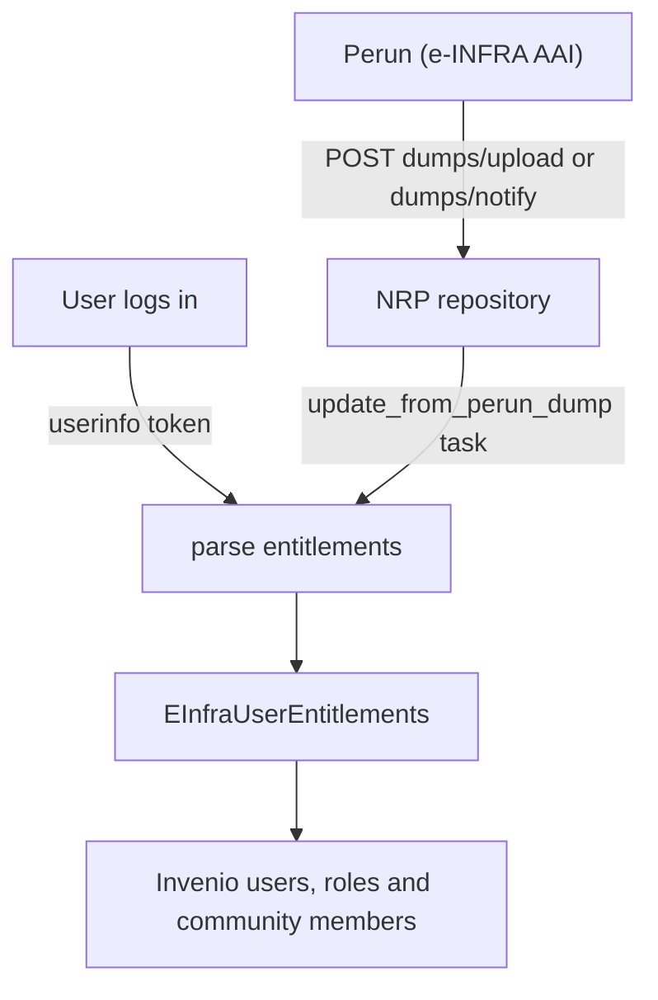

import { Callout } from "nextra/components";

# AAI — e-INFRA OIDC Authentication & Group Sync

<Callout type="info">
This page describes the current (RDM 14) state, as implemented in the
[oarepo-config](https://github.com/oarepo/oarepo-config) and
[oarepo-oidc-einfra](https://github.com/oarepo/oarepo-oidc-einfra) packages.
The main difference from RDM 12: synchronization is **one-way**. The repository reads
groups and roles from Perun, but no longer writes to Perun (no Perun REST API calls,
no community groups created in Perun, no AAI invitations).
</Callout>

## Overview

AAI (Authentication and Authorization Infrastructure) in an NRP repository does two things:

1. **Login** — users authenticate via e-INFRA/Perun OIDC (the same way as on other CESNET services)
2. **Group synchronization** — global roles and community memberships are taken from Perun entitlements:
   - **at login**, from the `eduperson_entitlement` claim of the user's userinfo token
   - **from the Perun dump**, which Perun pushes to the repository; this also updates the users' name, e-mail and organization, and removes memberships of users who are no longer in the dump

Both are configured in `invenio.cfg` with a single call to `config.configure_einfra_oidc()`.

---

## 1. Prerequisites (e-INFRA side)

Before configuring the repository, the following must be in place on the e-INFRA AAI side:

### 1.1 OIDC client in spadmin

Create an OIDC client in the [spadmin console](https://spadmin.e-infra.cz/):

| Configuration | Value |
|---|---|
| URL of login page | `https://<server>/oauth/login/e-infra/` |
| Redirect URIs | `https://<server>/oauth/authorized/e-infra/` <br/> `https://127.0.0.1:5000/oauth/authorized/e-infra/` (local development) |
| Flow | authorization code |
| Token endpoint auth | `client_secret_basic` |
| PKCE | none |
| Introspection | yes |
| Scopes | `openid profile email eduperson_entitlement organization` |

**Note:** The scope list is hardcoded in `oarepo-oidc-einfra` (in `remote.py`), not in the repository
configuration — in spadmin it is enough to allow `eduperson_entitlement` and `organization`.

### 1.2 Perun dump (optional)

Perun regularly generates a dump of users and groups and pushes it to the repository.
This is set up by the e-INFRA AAI team. The repository needs an S3 bucket to store the dumps
(see [2.2](#22-s3-dump-synchronization-variables-optional)) and a user account that Perun uses
to call the API. Allow this account to upload dumps:

```bash
invenio access allow upload-oidc-einfra-dump user <perun-account-email>
```

Without the dump, roles and memberships are still updated at every login.

### 1.3 e-INFRA eligible users (optional)

If you want e-INFRA eligible users to automatically receive rights, use `einfra_eligible_parser_factory`
from `oarepo-oidc-einfra`. By default, eligible users are granted the global `submitter` role;
additional community roles can be mapped as well. The roles are assigned at login.

The global roles must exist in the repository. If a role does not exist, it is skipped and only a
message is logged, so create it first:

```bash
invenio roles create submitter
```

See the example in [NRP-CZ/datarepo](https://github.com/NRP-CZ/datarepo/blob/main/invenio.cfg).

---

## 2. Repository configuration (`invenio.cfg`)

```python filename="invenio.cfg"
import oarepo_config as config

# ... other configuration ...

# AAI — e-INFRA OIDC
# Requires the oarepo-oidc-einfra package
from oarepo_oidc_einfra.remote import einfra_eligible_parser_factory

config.configure_einfra_oidc(
    entitlements_parser=einfra_eligible_parser_factory(
        # By default, e-INFRA eligible users are granted the global "submitter" role;
        # pass global_roles=None to disable it or a custom list to change it
        # global_roles=None,
        # community_roles=[("my-community", "curator")],
    )
)
```

What `configure_einfra_oidc()` does:

- When `INVENIO_REMOTE_AUTH_ENABLED` is `true` (also `yes`/`1`), merges an `"e-infra"` entry into `OAUTHCLIENT_REMOTE_APPS`
- Builds the `EINFRA` client configuration from `INVENIO_EINFRA_CONSUMER_KEY` and `INVENIO_EINFRA_CONSUMER_SECRET`
- When enabled, sets `USERPROFILES_READ_ONLY = True` (users cannot edit their profile, as it is managed by e-INFRA)
- When `INVENIO_REMOTE_AUTH_ENABLED` is not enabled, `OAUTHCLIENT_REMOTE_APPS` stays empty — AAI login is disabled
- When `entitlements_parser` is passed, sets `EINFRA_ENTITLEMENTS_PARSER`
- Requires the `oarepo-oidc-einfra` package; if it is missing, the application refuses to start

### 2.1 Required environment variables

| Variable | Description |
|---|---|
| `INVENIO_REMOTE_AUTH_ENABLED` | `true` to enable AAI login |
| `INVENIO_EINFRA_CONSUMER_KEY` | OIDC client key from spadmin |
| `INVENIO_EINFRA_CONSUMER_SECRET` | OIDC client secret from spadmin |

### 2.2 S3 dump synchronization variables (optional)

These deployment variables feed the `EINFRA_USER_DUMP_S3_*` configuration of `oarepo-oidc-einfra` —
you do not define them in `invenio.cfg`, just make them available in your deployment variables:

| Variable | Description |
|---|---|
| `INVENIO_EINFRA_USER_DUMP_S3_ACCESS_KEY` | Access key for the S3 bucket with Perun dumps |
| `INVENIO_EINFRA_USER_DUMP_S3_SECRET_KEY` | Secret key |
| `INVENIO_EINFRA_USER_DUMP_S3_ENDPOINT` | S3 endpoint (e.g. `https://s3.cl4.du.cesnet.cz`) |
| `INVENIO_EINFRA_USER_DUMP_S3_BUCKET` | Name of the bucket with dumps |

When all four are set, the dump sync is enabled. Perun then triggers the synchronization through the
repository API, and the `update_from_perun_dump` Celery task processes the dump:

| Endpoint | What Perun does |
|---|---|
| `POST /api/auth/oidc/einfra/dumps/upload` | Sends the dump in the request body; the repository stores it in the bucket |
| `POST /api/auth/oidc/einfra/dumps/notify` | Notifies that the dump was uploaded to the bucket at `EINFRA_LAST_DUMP_PATH` (default `nrp_invenio_export.json`) |

Both endpoints require the `upload-oidc-einfra-dump` permission (see [1.2](#12-perun-dump-optional)).

---

## 3. How group synchronization works



Entitlements have one of these forms:

- `urn:geant:cesnet.cz:res:communities:<community-slug>:role:<role>#perun.cesnet.cz` — membership in a community
- `urn:geant:cesnet.cz:res:roles:<role>#perun.cesnet.cz` — a global role

The `geant` namespace, the `cesnet.cz` prefix and the `perun.cesnet.cz` suffix can be changed with
`EINFRA_ENTITLEMENT_NAMESPACES`, `EINFRA_ENTITLEMENT_PREFIX` and `EINFRA_ENTITLEMENT_SUFFIX`.
Entitlements in another form, or for a community or role that does not exist, are ignored.

When an entitlement disappears, the repository removes the role or membership it granted. It only
removes what came from entitlements stored earlier in `EInfraUserEntitlements`; other roles and
memberships assigned in the repository are not touched.

Key changes compared to RDM 12:

- **One-way synchronization** — groups are no longer synchronized back to Perun since CESNET Invenio 14,
  and community roles set in the repository are not propagated to Perun
- **No Perun REST API** — the repository no longer creates groups or resources in Perun, and AAI
  invitations were removed; invitations and notifications are handled by the repository

---

## 4. Deployment checklist

- [ ] OIDC client created in spadmin with redirect URI `https://<server>/oauth/authorized/e-infra/`
- [ ] (Optional) Perun pushes dumps to the repository (contact the e-INFRA AAI team), and its account has the `upload-oidc-einfra-dump` permission
- [ ] `INVENIO_REMOTE_AUTH_ENABLED=true` in deployment variables
- [ ] `INVENIO_EINFRA_CONSUMER_KEY` and `INVENIO_EINFRA_CONSUMER_SECRET` set
- [ ] `INVENIO_EINFRA_USER_DUMP_S3_*` variables set (if you want group sync)
- [ ] `config.configure_einfra_oidc()` in `invenio.cfg`
- [ ] (Optional) `einfra_eligible_parser_factory()` for automatic role assignment, with the global roles (e.g. `submitter`) created
- [ ] Celery workers running

## 5. Production example (datarepo)

From [NRP-CZ/datarepo](https://github.com/NRP-CZ/datarepo/blob/main/invenio.cfg):

```python filename="invenio.cfg"
from oarepo_oidc_einfra.remote import einfra_eligible_parser_factory

config.configure_einfra_oidc(
    entitlements_parser=einfra_eligible_parser_factory()
)
```

And in deployment variables (the values are placeholders):

```bash filename="variables"
# AAI login
INVENIO_REMOTE_AUTH_ENABLED=true
INVENIO_EINFRA_CONSUMER_KEY="..."
INVENIO_EINFRA_CONSUMER_SECRET="..."

# Perun dump sync (optional)
INVENIO_EINFRA_USER_DUMP_S3_ACCESS_KEY="..."
INVENIO_EINFRA_USER_DUMP_S3_SECRET_KEY="..."
INVENIO_EINFRA_USER_DUMP_S3_ENDPOINT="https://s3.cl4.du.cesnet.cz"
INVENIO_EINFRA_USER_DUMP_S3_BUCKET="perun-dumps"
```

## 6. Troubleshooting

| Problem | Cause | Solution |
|---|---|---|
| "e-INFRA" login button not shown | `INVENIO_REMOTE_AUTH_ENABLED` is not `true` | Set it in deployment variables |
| No groups after login | The user's entitlements do not match an existing community or role | Check the entitlements in the userinfo token and that the communities and roles exist |
| Dump changes not applied | Dump sync not configured, or Perun is not allowed to call the API | Check the `INVENIO_EINFRA_USER_DUMP_S3_*` variables, the `upload-oidc-einfra-dump` permission and Celery workers |
| Eligible users do not get `submitter` | The role does not exist | `invenio roles create submitter` |
| API clients get 403 on public endpoints | With e-INFRA enabled, a bearer JWT that fails e-INFRA validation is rejected (repository personal access tokens are not affected) | Send a valid e-INFRA token, a personal access token, or no `Authorization` header |
| `USERPROFILES_READ_ONLY` is `True` and users complain | By design in RDM 14 — the profile is managed by e-INFRA | Tell users to change their profile in Perun |
| Entitlements not synchronized | Missing or misconfigured entitlements parser | Check `einfra_eligible_parser_factory` and the entitlement format in the dump |
